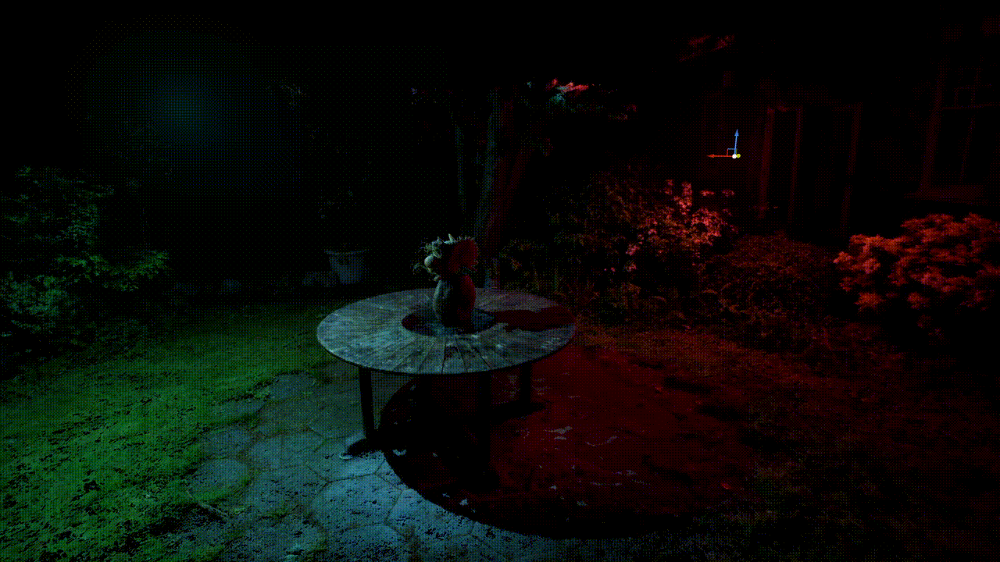

# StarLightGS

Co**STAR** Re**Light**ing **G**aussian **S**plats

Gaussian splat renderer for Unreal Engine 5.7+ with a focus on relighting and native shadow rendering (without proxy meshes).

> [!TIP]
> Check out our [sample project](https://github.com/CoSTAR-National-Lab/starlightgs-sample) to see the plugin in action.

> [!TIP]
> Create your own relightable gaussian splats with our [training pipeline](https://github.com/CoSTAR-National-Lab/relighting-gaussians-training), built on [GS-IR](https://github.com/lzhnb/gs-ir).

## Description
This plugin features:
- High performance rendering handling 10+ million splats.
- Relighting support.
- Interoperability with meshes and splats.
- Native shadow-casting for Gaussian Splats onto meshes and other splats.
- Splats receive shadows and global illumination from meshes.

This plugin supports rendering of splats with and without relighting. To use relighting, your PLY files must have per-splat normals. This can be achieved through using [our training pipeline](https://github.com/CoSTAR-National-Lab/relighting-gaussians-training).

> [!CAUTION]
> StarLightGS does not yet support relighting with Substrate!
> Substrate is enabled by-default from Unreal Engine 5.7 onwards.
> Disable Substrate from project settings to use Gaussian Splat relighting with StarLightGS.

## Getting Started
### Requirements
- Unreal Engine 5.7 or newer.
- Visual Studio 2022 or newer.
### Installing
- Place StarLightGS into the Plugins folder in your project. If one doesn't exist, then create a new folder.
- Regenerate Visual Studio project files by right-clicking your `.uproject` and selecting "Generate Visual Studio project files". On Windows 11, you may have to select "Show more options..." first.
- Open the generated `.sln` in Visual Studio.
- Press F5 to build and run the project.
### Basic Usage
- From the content browser, click 'Import'.
- Navigate to and select your PLY file.
- Click 'Import' in the import dialogue to import the PLY as a Gaussian Splat asset.
- Drag and drop the Gaussian Splat asset onto the viewport to place it into the level.
- If your PLY supports relighting, relighting will be function out-of-the-box.

See the [Usage Guide](Docs/StarLightGS_Usage_Guide.md) for how to use all features of the plugin.

> [!IMPORTANT]
> By default, StarLightGS is set to a maximum of 5,000,000 splats. This is to bound runtime memory overhead by default, but the plugin will support as many splats as you have VRAM. The maximum number of splats can be increased via the `r.Gaussians.MaxSplats` console variable.
> E.g., to increase your project maximum to 10,000,000 splats, add the following line to your `DefaultEngine.ini` beneath `[/Script/Engine.RendererSettings]`:
> `r.Gaussians.MaxSplats=10000000`

## License
This project is licensed under the MIT License - see the LICENSE file for details.
